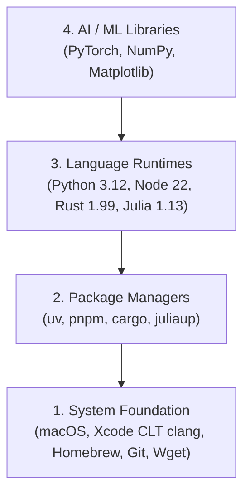

# Session Notes: Dev Environment & Setup
**Date:** October 29, 2026  
**Curriculum:** AI Engineering from Scratch (Volume 1: Foundations)  
**Phase:** 00 (Setup & Tooling) — Lesson 01

---

````carousel
### Slide 1: The Four-Layer AI Stack

Every AI engineering system is built bottom-up across four distinct layers:



#### What We Installed:
1. **Layer 1 (System):** Xcode Command Line Tools (`clang`), Homebrew (`/opt/homebrew/`), Git (`/opt/homebrew/bin/git`), `wget`.
2. **Layer 2 (Package Managers):** `uv` (in `~/.local/bin`), `fnm`, `cargo` (in `~/.cargo/bin`), `juliaup`.
3. **Layer 3 (Runtimes):** Python 3.12.16, Node.js 22.23.4, Rustc 1.99.1, Julia 1.13.3.
4. **Layer 4 (Libraries):** NumPy 2.5, Matplotlib, Jupyter, PyTorch with Apple MPS.

<!-- slide -->
### Slide 2: Why `uv` & Virtual Environments

#### The Problem: "Dependency Hell"
- Installing packages globally with `pip` pollutes your Mac and causes conflicting versions across projects.
- Standard `pip` and `pyenv` compile from C source slowly and take 15–30 minutes for large deep learning wheels.

#### The Modern Solution: `uv`
- **Replaces 4 tools in one:** `pyenv` (Python versions), `venv` (environments), `pip` (packages), and `poetry` (locks).
- **Written in Rust:** 10x to 100x faster downloads and installs.
- **Smart Global Caching:** Downloads multi-gigabyte PyTorch wheels once and hard-links them across projects without wasting disk space.

#### Essential Commands:
```bash
uv python install 3.12            # Download standalone Python 3.12
uv venv --python 3.12             # Create isolated .venv sandbox
source .venv/bin/activate         # Put .venv/bin in front of $PATH
uv pip install numpy torch ...    # Install into .venv sandbox
```

<!-- slide -->
### Slide 3: Terminal Mastery & Editors

#### Terminal Mechanics:
* **`mkdir -p <dir>`**: Creates directory safely without failing if it already exists.
* **`source <script>`**: Executes commands directly in your *current* terminal session (rather than in a child subshell).
* **`python -c '...'` / `node -e '...'`**: Evaluates code directly as a command-line string and exits immediately.

#### Editors:
* **`nano <file>`**: Standard built-in terminal editor.
  - Save: `Ctrl + O` $\rightarrow$ `Enter`
  - Exit: `Ctrl + X`
* **`micro <file>`**: Modern alternative (`brew install micro`) with standard `Ctrl+S`, `Ctrl+Q`, and trackpad/mouse support.
* **VS Code / Cursor CLI**: `code <file>` or `code .` opens GUI editor straight from terminal.

<!-- slide -->
### Slide 4: Four Languages & How They Run

We wrote, compiled, and executed code across all 4 core curriculum runtimes:

| Language | File | Command | Execution Model |
| :--- | :--- | :--- | :--- |
| **Python** | `scratch/hello.py` | `python scratch/hello.py` | Interpreted / dynamic bytecode |
| **TypeScript** | `scratch/hello.ts` | `npx tsx scratch/hello.ts` | Transpiled on-the-fly via `tsx` into Node |
| **Rust** | `scratch/hello.rs` | `rustc file.rs -o bin && ./bin` | Ahead-of-time compiled machine binary |
| **Julia** | `scratch/hello.jl` | `julia scratch/hello.jl` | High-performance dynamic JIT for math |

> [!NOTE]
> In Rust, `println!` ends with `!` because it is a **macro** (code that expands at compile time). It supports flexible argument counts and validates format strings *before* running.

<!-- slide -->
### Slide 5: Apple Silicon GPU & Placement Results

#### Mac Hardware Acceleration:
* **CUDA:** Exclusive to NVIDIA GPUs (Linux/Windows). On Mac, `torch.cuda.is_available()` returns `False`.
* **MPS (Metal Performance Shaders):** Apple's native GPU framework. On Apple Silicon, verify with:
  ```python
  import torch
  print(torch.backends.mps.is_available())  # True on Apple Silicon!
  ```

#### Placement Diagnostic (`find-your-level`):
* **Score:** 1 / 10
* **Starting Point:** **Phase 1: Math Foundations** (Vectors, Matrices, Calculus, Probability)
* **Status:** Phase 00 (Dev Environment) is 100% verified and complete!
* **Next Stop:** **Phase 00, Lesson 02: Git & Collaboration**

<!-- slide -->
### Slide 6: Your Personalized Curriculum Roadmap

**Total Curriculum:** ~1,134 estimated hours across 19 phases (~514 hours excluding capstones).

| Phase | Topic | Status | Est. Hours |
|:---:|:---|:---:|:---:|
| **00** | **Setup & Tooling** (Dev Env, Git, GPUs, Shell) | **In Progress** | 16h |
| **01** | **Math Foundations** (Vectors, Matrices, Calculus, Prob) | **Do** | 23h |
| **02** | **ML Fundamentals** (Linear/Logistic, Trees, K-Means) | **Do** | 26h |
| **03** | **Deep Learning Core** (Backpropagation, PyTorch) | **Do** | 15h |
| **04** | **Computer Vision** (CNNs, Vision Transformers) | **Do** | 27h |
| **05** | **NLP — Foundations to Advanced** (Word2Vec, RNNs) | **Do** | 30h |
| **06** | **Speech & Audio** (Spectrograms, Whisper, TTS) | **Do** | 18h |
| **07** | **Transformers Deep Dive** (Attention from Scratch) | **Do** | 14h |
| **08** | **Generative AI** (Diffusion Models, VAEs, GANs) | **Do** | 14h |
| **09** | **Reinforcement Learning** (Q-Learning, Policy Gradients) | **Do** | 13h |
| **10** | **LLMs from Scratch** (Pretraining, Tokenization, RoPE) | **Do** | 26h |
| **11** | **LLM Engineering** (Prompting, RAG, LoRA Fine-Tuning) | **Do** | 19h |
| **12** | **Multimodal AI** (CLIP, Vision-Language Models) | **Do** | 65h |
| **13** | **Tools & Protocols** (MCP, Function Calling) | **Do** | 76h |
| **14** | **Agent Engineering** (ReAct, Planning, Memory) | **Do** | 55h |
| **15** | **Autonomous Systems** (Long-Horizon Tasks, Sandboxes) | **Do** | 20h |
| **16** | **Multi-Agent & Swarms** (Orchestration, Consensus) | **Do** | 28h |
| **17** | **Infrastructure & Production** (vLLM, Serving, Scaling) | **Do** | 34h |
| **18** | **Ethics, Safety & Alignment** (RLHF, DPO, Guardrails) | **Do** | 31h |
| **19** | **Capstone Projects** (End-to-End Production Systems) | **Do** | 620h |

<!-- slide -->
### Slide 7: How to Resume Your Work Tomorrow

#### 1. Re-activating Your Terminal Environment:
Open your terminal and step back into the project sandbox:
```bash
cd "/Users/ponti/Desktop/AI from scratch/ai-engineering-from-scratch"
source .venv/bin/activate
```
*(Your prompt will show `(ai-engineering-from-scratch)`)*.

#### 2. Resuming in this Chat:
Simply send:
> *"I'm ready to continue with Phase 00, Lesson 02: Git & Collaboration!"*

#### 3. If Starting a New Chat:
Say:
> *"I am working through AI Engineering from Scratch. We finished Phase 00, Lesson 01 (Dev Environment) and are starting Phase 00, Lesson 02 (Git & Collaboration) using the how-to-learn structure."*

#### 4. Scheduled Session:
* **Time:** Friday, October 30, 2026 at 10:00 AM – 11:30 AM
* **Calendar Invite:** Added to Google Calendar (`jdponticelli@gmail.com`).
````
