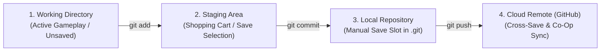
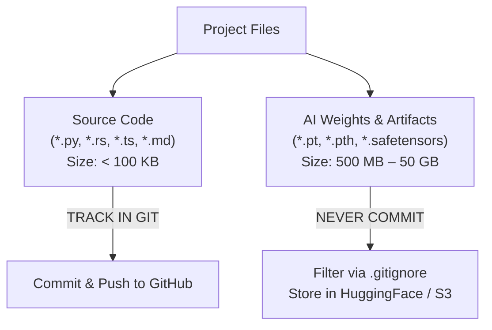

# Session Notes: Git & Collaboration
**Date:** October 30, 2026  
**Curriculum:** AI Engineering from Scratch (Volume 1: Foundations)  
**Phase:** 00 (Setup & Tooling) — Lesson 02: Git & Collaboration  
**Quiz Score:** 3 / 3 (100%)

---

````carousel
### Slide 1: The Video Game Mental Model for Git

Git is essentially a comprehensive save-file and timeline manager for your code:



#### Mapping to Game Concepts:
1. **Working Directory:** Active unsaved gameplay. Editing files in VS Code / terminal.
2. **Staging Area (`git add`):** Your inventory selection screen. You choose exactly which changes enter the next save slot.
3. **Commit (`git commit`):** An immutable, timestamped save slot with a unique hash ID and description.
4. **Branch (`git checkout -b`):** An alternate save file for safe experiments without risking your primary playthrough.
5. **Remote / GitHub (`git push`):** Cloud cross-save backup and collaboration hub.
6. **`.gitignore`:** The auto-loot filter that discards heavy junk (huge AI weight boulders).

<!-- slide -->
### Slide 2: The Three Local Zones & Daily Workflow

Every change moves through three distinct local states before uploading to GitHub:

```mermaid
sequenceDiagram
    participant WD as Working Directory (Local Files)
    participant SA as Staging Area (The Cart)
    participant LR as Local Repo (.git)
    participant R as Remote (GitHub Fork)

    Note over WD: Red in 'git status' (Untracked / Modified)
    WD->>SA: git add <file>
    Note over SA: Green in 'git status' (Changes to be committed)
    SA->>LR: git commit -m "feat(...): ..."
    Note over LR: Clean working tree; commit etched into history
    LR->>R: git push -u origin <branch>
    Note over R: Cloud synchronized!
```

#### The Daily Loop:
```bash
git status                     # Check what's dirty (red)
git add <path>                 # Put changes in the cart (turns green)
git commit -m "type(scope): msg" # Freeze into a permanent save point
git push                       # Sync to cloud
```

<!-- slide -->
### Slide 3: Conventional Commits Standard

Engineering teams use structured commit messages so histories are cleanly searchable:

| Type | Purpose | Example |
| :--- | :--- | :--- |
| **`feat`** | New feature or code | `feat(phase-00): add multi-language hello world scripts` |
| **`fix`** | Bug fix | `fix(loader): prevent NaN division on empty batches` |
| **`docs`** | Documentation only | `docs: add setup instructions for Apple MPS` |
| **`refactor`** | Code restructure (no behavior change) | `refactor: extract data preprocessing into helper` |
| **`chore`** | Maintenance, dependencies, tooling | `chore: update .gitignore rules` |

<!-- slide -->
### Slide 4: AI Engineering & The `.gitignore` Rule

In standard software, all files are small text files. In AI engineering, datasets and model weights are gigabytes of binary data:



#### Why Model Checkpoints are Ignored:
- Git tracks complete history. Committing a 2 GB file inflates `.git` forever, even if deleted in the next commit.
- GitHub blocks pushes with files exceeding 100 MB.
- Always include `*.pt`, `*.pth`, `*.safetensors`, and `*.onnx` in `.gitignore`.

<!-- slide -->
### Slide 5: What We Built & Configured Today

1. **Player Profile Configured:**
   - `user.name = yosifka`
   - `user.email = jdponticelli@gmail.com`
2. **Personal Fork & Branch:**
   - Created isolated progress branch: `my-progress`.
   - Connected remote to personal GitHub fork: `https://github.com/yosifka/ai-engineering-from-scratch.git`.
3. **First Official Commit:**
   - Staged real source files from Lesson 01: `hello.jl`, `hello.py`, `hello.rs`, `hello.ts`.
   - Cleaned unneeded binary: `rm scratch/hello_rust`.
   - Sealed commit: `feat(phase-00): add multi-language hello world scripts from lesson 01`.
4. **Cloud Push Completed:**
   - Pushed `my-progress` with upstream tracking (`-u`).
   - Verified commit history with `git log --oneline`.

<!-- slide -->
### Slide 6: How to Resume Next Session

#### 1. Activate Environment:
```bash
cd "/Users/ponti/Desktop/AI from scratch/ai-engineering-from-scratch"
source .venv/bin/activate
```

#### 2. Confirm Active Branch:
```bash
git status
# Should report: "On branch my-progress, your branch is up to date"
```

#### 3. Next Lesson:
* **Phase 00, Lesson 03: GPU Setup & Cloud** (`phases/00-setup-and-tooling/03-gpu-setup-and-cloud/docs/en.md`).

<!-- slide -->
### Slide 7: Session Wrap-Up & Milestone Summary

* **Date Completed:** October 31, 2026 at 00:06 CET
* **Phase:** 00 (Setup & Tooling)
* **Lesson:** 02 (Git & Collaboration) — **Complete ✅**
* **Quiz Result:** 3 / 3 (100%)
  - Q1: `C` (git add → git commit → git push)
  - Q2: `A` (create & switch to branch)
  - Q3: `A` (model checkpoint size hygiene)
* **Remote Sync:** Verified push to `origin/my-progress` on GitHub (`yosifka/ai-engineering-from-scratch`).
* **Next Session Trigger:**
  > *"I'm ready for Phase 00, Lesson 03: GPU Setup & Cloud!"*
````
