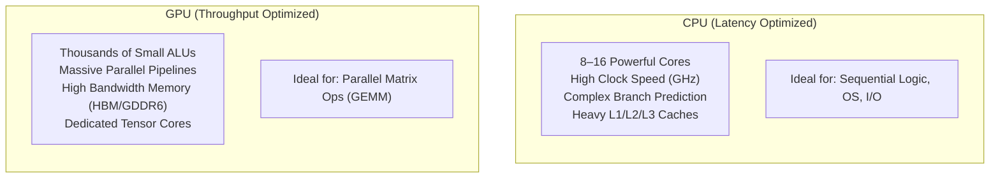
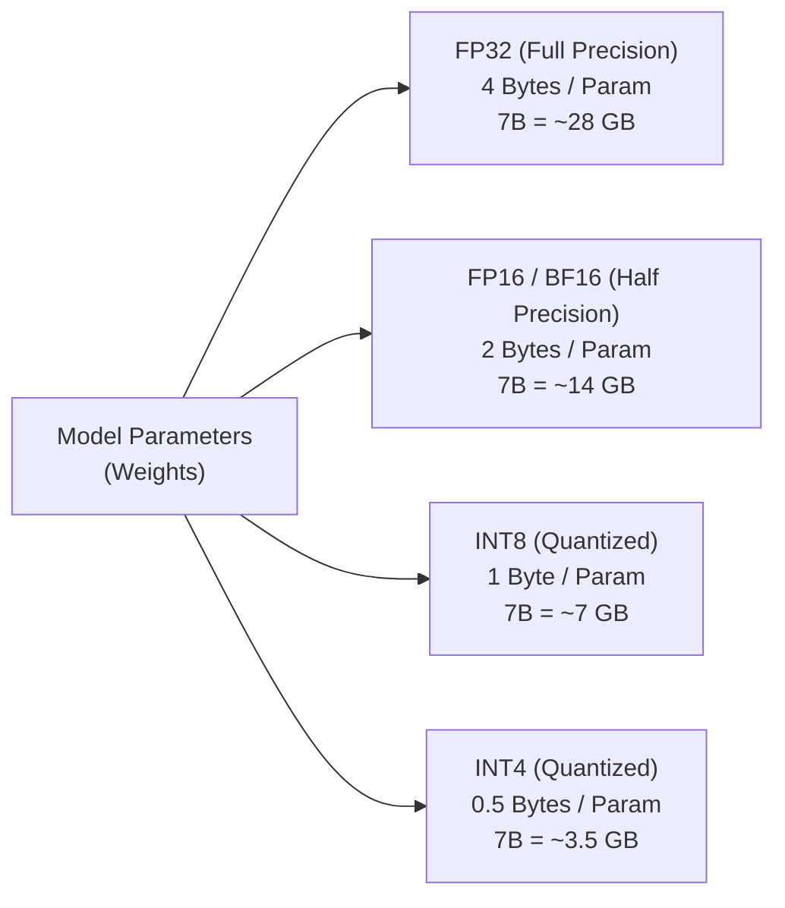
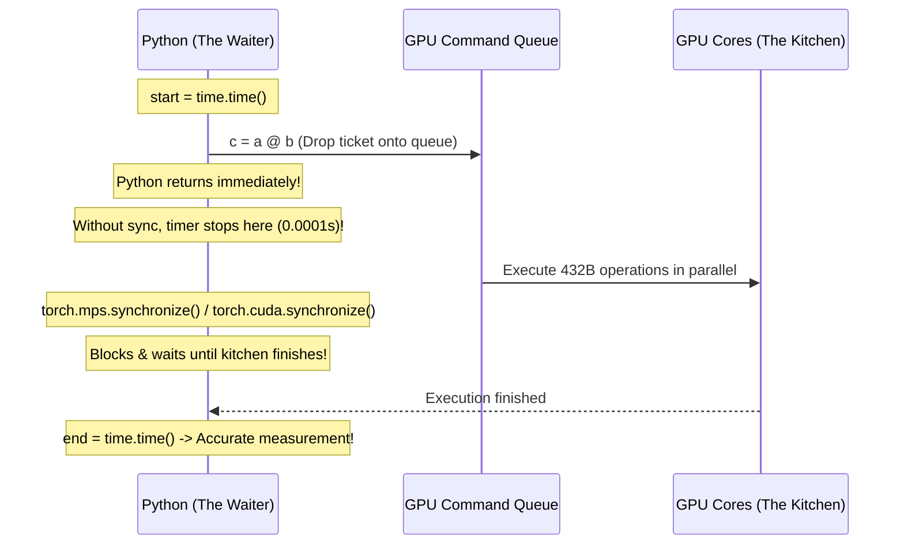
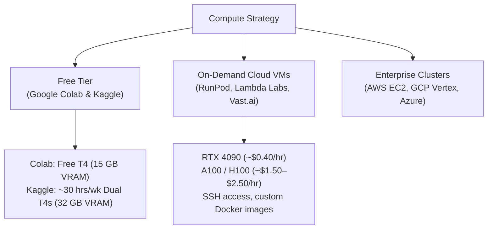

# Session Notes: GPU Setup & Cloud
**Date:** October 31, 2026  
**Curriculum:** AI Engineering from Scratch (Volume 1: Foundations)  
**Phase:** 00 (Setup & Tooling) — Lesson 03: GPU Setup & Cloud  
**Quiz Score:** 3 / 3 (100%)

---

````carousel
### Slide 1: CPU vs. GPU Architecture (The Brain vs. The Army)

Why GPUs dominate AI and machine learning workloads:



#### Core Differences:
1. **MIMD vs. SIMD:**
   - **CPU:** *Multiple Instruction, Multiple Data* — handles branching, complex control flow, and serial tasks.
   - **GPU:** *Single Instruction, Multiple Data* — applies identical mathematical operations across millions of numbers simultaneously.
2. **GEMM (General Matrix Multiply):**
   - 99% of deep learning (convolutions, self-attention, feed-forward layers) boils down to $Y = WX + b$.
   - A single $6000 \times 6000$ matrix multiply executes $\approx 4.32 \times 10^{11}$ (432 billion) floating-point calculations!

<!-- slide -->
### Slide 2: VRAM & The 2-Byte Rule of Thumb

Memory (VRAM) is the ultimate hard physical boundary in AI engineering:



#### The Sizing Formula:
$$\text{VRAM Minimum (GB)} \approx \text{Billions of Parameters} \times 2$$

#### Inference vs. Training Budget:
- **Inference (Running):** $\text{Weights} + \text{KV Cache} + \text{Activations} \approx 1.2 \times \text{Model Size}$.
- **Training (Learning):** $\text{Weights} + \text{Gradients} + \text{Optimizer States (Adam = 8 bytes/param)} + \text{Activations} \approx 4\times \text{ to } 6\times \text{Model Size}$!
- *Example:* Fine-tuning a 7B model uncompressed requires over 100 GB VRAM unless using LoRA/QLoRA and mixed precision (`torch.amp`).

<!-- slide -->
### Slide 3: The Asynchronous Execution Model & Synchronization

Why PyTorch code requires explicit synchronization when timing GPU workloads:



#### Key Rules:
* GPU calls are non-blocking / asynchronous.
* Always call `torch.cuda.synchronize()` (or `torch.mps.synchronize()`) before and after stopping high-precision timers.
* Always include a **warmup pass** so GPU kernel compilation and memory allocation overhead don't skew benchmarks.

<!-- slide -->
### Slide 4: Apple Silicon Metal (`mps`) vs. NVIDIA CUDA (`cuda`)

Hardware ecosystems for AI practitioners:

| Feature | Apple Silicon (Mac) | NVIDIA GPU (PC / Cloud) |
| :--- | :--- | :--- |
| **Backend** | Metal Performance Shaders (`mps`) | CUDA + cuDNN (`cuda`) |
| **Memory** | **Unified Memory** (Zero copy CPU ↔ GPU) | **Dedicated VRAM** (PCIe bus transfer) |
| **Status Tool** | macOS Activity Monitor | `nvidia-smi` |
| **Specialized Hardware**| Neural Engine + Apple AMX coprocessors | Tensor Cores (FP16/INT8 matrix engines) |
| **Industry Role** | Local development, debugging, prototyping | Large-scale training, TensorRT edge deployment |

#### Portable Device Pattern:
```python
import torch

device = torch.device(
    "cuda" if torch.cuda.is_available() else 
    "mps" if torch.backends.mps.is_available() else 
    "cpu"
)
print(f"Using compute device: {device}")
```

<!-- slide -->
### Slide 5: The Cloud Compute Tier

When local hardware isn't enough, tap into cloud GPUs:



#### Essential `nvidia-smi` Fields:
* **GPU Utilization %:** Are your tensor cores saturated?
* **Memory Usage (VRAM):** Tracking memory to prevent Out of Memory (OOM) errors.
* **Temperature & Power Draw:** Ensuring hardware thermal stability under sustained load.

<!-- slide -->
### Slide 6: What We Built & Benchmarked Today

1. **Benchmarking Script Built:**
   - Wrote [`scratch/matrix_calculation.py`](file:///Users/ponti/Desktop/AI%20from%20scratch/ai-engineering-from-scratch/scratch/matrix_calculation.py) implementing a warmup pass, asynchronous queue flushing, and comparative matrix multiplication.
2. **Apple Silicon Live Benchmark Results ($6000 \times 6000$ Matrices):**
   - **CPU Time:** `0.5008s`
   - **MPS GPU Time:** `0.2619s`
   - **Observed Speedup:** **`1.91x`**
3. **Mathematical Validation:**
   - Calculated VRAM requirements for a 12B parameter model ($12 \times 2 = 24\text{ GB}$).
   - Discovered the real-world overhead factor (why 24 GB needs quantization to prevent OOM).

<!-- slide -->
### Slide 7: Session Wrap-Up & Milestone Summary

* **Date Completed:** October 31, 2026
* **Phase:** 00 (Setup & Tooling)
* **Lesson:** 03 (GPU Setup & Cloud) — **Complete ✅**
* **Quiz Result:** 3 / 3 (100%)
  - Q1: `B` (`nvidia-smi` is the standard NVIDIA monitoring tool)
  - Q2: `C` (GPUs excel due to thousands of parallel matrix cores)
  - Q3: `B` (GPU calls are asynchronous and require `synchronize()` for accurate timing)
* **Next Lesson:**
  > **Phase 00, Lesson 04: APIs & Keys** (`phases/00-setup-and-tooling/04-apis-and-keys/docs/en.md`)
````
