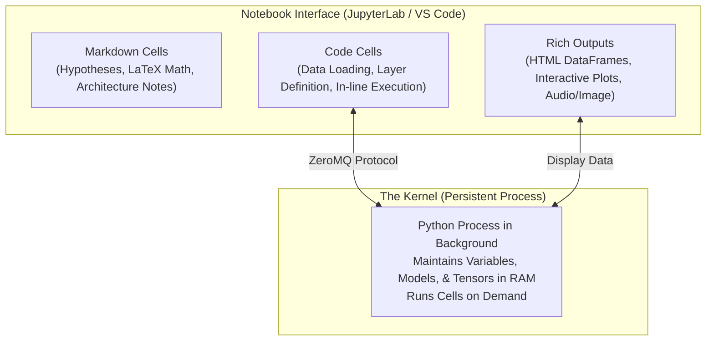
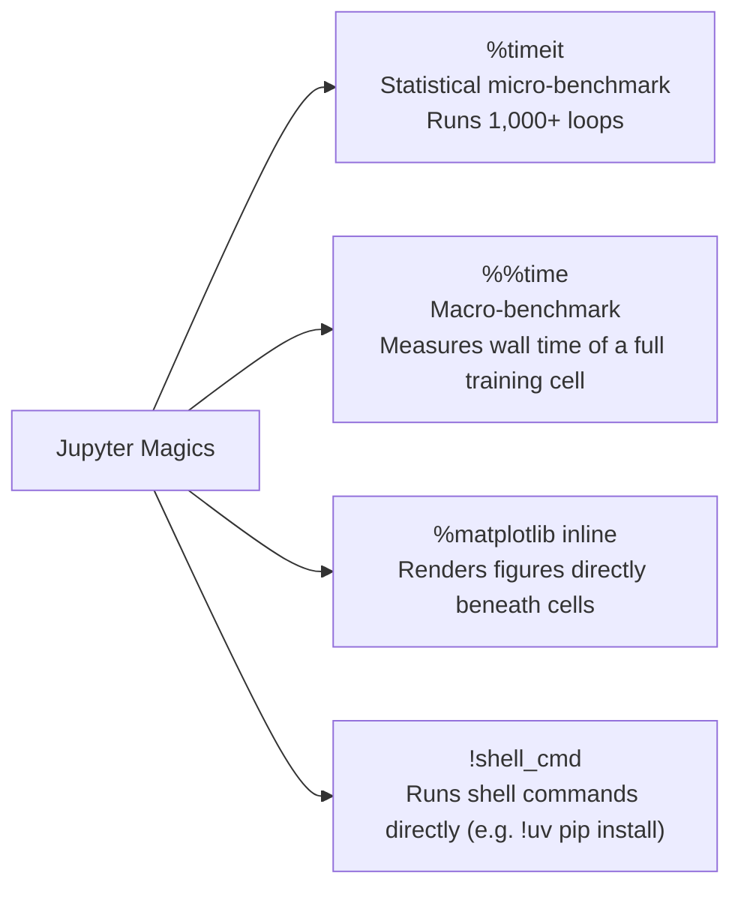
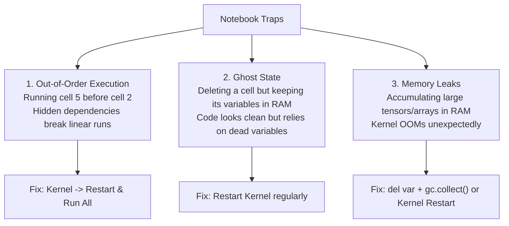

# Session Notes: Jupyter Notebooks
**Date:** October 31, 2026  
**Curriculum:** AI Engineering from Scratch (Volume 1: Foundations)  
**Phase:** 00 (Setup & Tooling) — Lesson 05: Jupyter Notebooks  
**Quiz Score:** 4 / 4 (100%)

---

````carousel
### Slide 1: The Lab Bench Architecture

Why Jupyter Notebooks (`.ipynb`) are the universal prototyping scratchpad for AI:



#### Core Components:
1. **Interactive Cells:** Run code in chunks rather than re-executing entire `.py` files from scratch.
2. **The Kernel:** The persistent execution engine that retains variables, trained weights, and imports in memory across cell runs.
3. **Rich Media:** Automatically renders formatted tables (`pandas`), interactive plots (`matplotlib`), and images inline.

<!-- slide -->
### Slide 2: The Golden Rule: "Explore in Notebooks, Ship in Scripts"

Understanding the engineering boundary between prototyping and production:

| Workflow Dimension | Notebooks (`.ipynb`) | Scripts & Modules (`.py`) |
| :--- | :--- | :--- |
| **Primary Goal** | Exploration, data analysis, visualization | Production inference, automated training runs |
| **Execution Model**| Non-linear, interactive, cell-by-cell | Linear, reproducible (top-to-bottom) |
| **State Management**| Stateful (kernel persists in memory) | Stateless / Managed via structured functions |
| **Testing & CI** | Difficult to test with standard test runners | Easily tested with `pytest` and CI/CD pipelines |
| **Git Collaboration**| JSON diffs can be messy | Clean, readable line-by-line diffs and PRs |

#### The Engineering Cycle:
1. **Explore:** Inspect distributions, visualize sensor data, and tune hyperparameters in a notebook.
2. **Refactor:** Extract validated data loaders and model architectures into pure Python functions.
3. **Ship:** Package into `.py` modules with typing, docstrings, unit tests, and CLI entry points.

<!-- slide -->
### Slide 3: Essential Jupyter Magic Commands

Special environment directives prefixed with `%` (single line) or `%%` (entire cell):



#### Micro vs. Macro Timing Comparison:
- **`%timeit` (Micro-benchmarking / Statistical Timing):** Runs the code in a loop many times (thousands of iterations) to calculate mean and standard deviation (`mean ± std`). Used for comparing fast operations (e.g., list comprehension vs. vectorization).
- **`%%time` (One-Shot Wall Timing):** Runs the entire cell **once** from start to finish and reports elapsed wall time and CPU time. Used for long operations (e.g., dataset loading, training epochs) where repeating 1,000 times would hang or crash your session.

#### Syntax Reference:
```python
# Micro-benchmark a single operation (loops multiple times)
%timeit np.random.randn(10000)

# Time an entire training block (runs once)
%%time
train_model(epochs=10)

# Shell command execution
!pip install scikit-learn
```

<!-- slide -->
### Slide 4: The Three Big Notebook Traps (And How to Fix Them)

Avoid the three classic foot-guns that cause debugging nightmares:



<!-- slide -->
### Slide 5: What We Built & Benchmarked Today

1. **Jupyter Environment Configured:**
   - Linked VS Code notebook runner to project kernel: `ai-engineering-from-scratch (3.12.16)`.
   - Rapidly resolved missing dependency using `uv pip install pandas`.
2. **Hands-On Exercises Completed in `scratch/first_notebook.ipynb`:**
   - **Exercise 1 (Micro-benchmarking):**
     - Python List Comprehension ($100,000$ elements): `3.64 ms` ($3640\text{ µs}$)
     - NumPy Vectorized ($100,000$ elements): `31.9 µs`
     - **Observed Speedup:** **`114x` faster!**
   - **Exercise 2 (Markdown & Visualizations):**
     - Authored Markdown documentation cell.
     - Built and displayed Pandas DataFrame with model accuracy.
     - Generated and rendered an inline Matplotlib bar chart directly under the cell.
   - **Linear Execution Verified:**
     - Executed **Kernel $\rightarrow$ Restart & Run All** to verify zero ghost-state dependencies.

<!-- slide -->
### Slide 6: Session Wrap-Up & Milestone Summary

* **Date Completed:** October 31, 2026
* **Phase:** 00 (Setup & Tooling)
* **Lesson:** 05 (Jupyter Notebooks) — **Complete ✅**
* **Exercises Completed:** 1 & 2 verified hands-on in `scratch/first_notebook.ipynb`
* **Quiz Result:** 4 / 4 (100%)
  - Q1: `C` (Kernel is the background process executing cells and maintaining state)
  - Q2: `A` (`%timeit` runs statistical loops; `%%time` measures one-shot wall time)
  - Q3: `B` (Out-of-order execution is the primary cause of broken linear notebooks)
  - Q4: `C` (Move code into `.py` when building reusable utilities, pipelines, or production software)
* **Next Lesson:**
  > **Phase 00, Lesson 06: Python Environments** (`phases/00-setup-and-tooling/06-python-environments/docs/en.md`)
````
