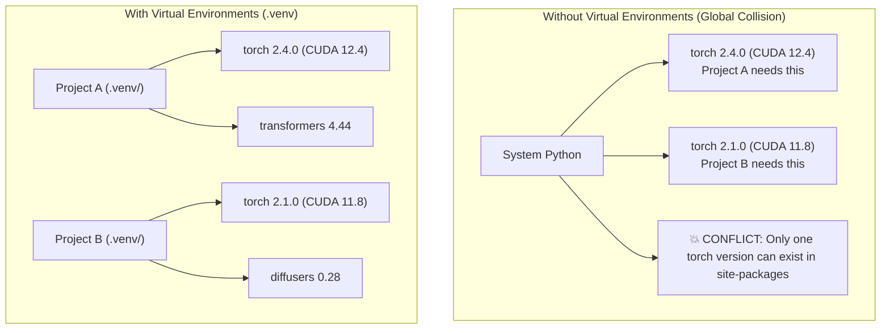
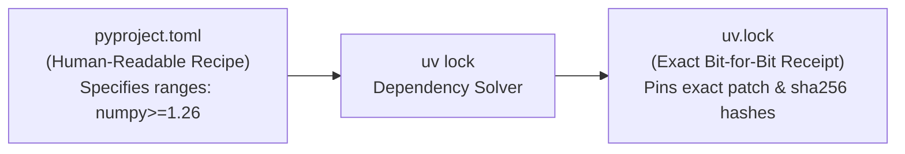
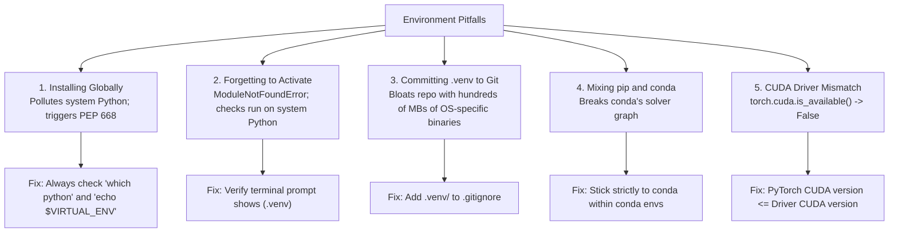

# Session Notes: Python Environments
**Date:** November 2, 2026  
**Curriculum:** AI Engineering from Scratch (Volume 1: Foundations)  
**Phase:** 00 (Setup & Tooling) — Lesson 06: Python Environments  
**Quiz Score:** 5 / 5 (100%)

---

````carousel
### Slide 1: The Core Architecture: Isolation vs. Dependency Hell

Why isolated virtual environments are essential for AI/ML engineering:



#### Core Components:
1. **Isolated Interpreter:** Symlinks or points to a specific Python version (e.g. Python 3.12).
2. **Private `site-packages`:** Each project holds its own directory of third-party libraries.
3. **Activation Script:** Temporarily prepends `.venv/bin` to your shell's `$PATH`.

<!-- slide -->
### Slide 2: Package Managers Compared

Choosing the right tool for the job:

| Tool | Speed | Scope | Best Use Case |
| :--- | :--- | :--- | :--- |
| **`uv`** | ⚡️ 10–100× faster (Rust) | Python packages, Python versions, lockfiles | **Default tool of choice** for modern workflows |
| **`venv`** | 🐢 Standard pip speed | Built-in Python package isolation | Fallback when third-party tools cannot be installed |
| **`conda`** | ⚖️ Moderate | Python + non-Python system binaries (CUDA, C++) | Shared HPC clusters, non-Python system dependencies |

#### The Golden Rule of Conda:
> Never mix `pip install` randomly inside a Conda environment. Let Conda resolve dependencies to avoid corrupting its solver.

<!-- slide -->
### Slide 3: Modern Packaging: `pyproject.toml` & Lockfiles

The transition from fragmented configs to modern unified standards (PEP 518 / PEP 621):



#### Syntax Reference:
```toml
[project]
name = "my-ai-project"
version = "0.1.0"
requires-python = ">=3.11"
dependencies = [
    "torch>=2.0",
    "anthropic>=0.39.0",
]

[project.optional-dependencies]
dev = ["pytest>=8.0", "ruff>=0.3.0"]
```

#### Installation Patterns:
- Install base + optional group: `uv pip install -e ".[dev]"`
- Generate lockfile: `uv lock`
- Reproducible install: `uv sync`

<!-- slide -->
### Slide 4: The Five Classic Pitfalls & How to Avoid Them



<!-- slide -->
### Slide 5: Hands-On Exercises Completed Live

1. **Exercise 1: Base Environment Verification (`env_setup.sh`)**
   - Verified Python 3.12.16 and `uv 0.13.6`.
   - Verified core packages: NumPy 2.5.4, Matplotlib 3.11.2, Scikit-Learn 1.9.1, Pandas 3.1.0, Jupyter 5.9.1.
   - Live matrix multiplication `(3, 3) @ (3, 3)` passed.

2. **Exercise 2: Isolation Proof**
   - Spun up temporary environment with pinned `numpy==1.26.4`.
   - Verified side-by-side: `Current env = 1.26.4` vs. `Main env = 2.5.4`.

3. **Exercise 3: Configuration & Dependency Resolution**
   - Authored custom `pyproject.toml` with `torch` and `anthropic`.
   - Ran `uv lock` in terminal: resolved **47 transitive packages in 246ms** and produced `uv.lock`.

4. **Exercise 4: Global Trap & PEP 668 Inspection**
   - Triggered PEP 668 guardrail on unmanaged global install attempt.
   - Inspected global path: `~/.local/share/uv/python/.../site-packages`.
   - Cleanly uninstalled test package to leave system untouched.

<!-- slide -->
### Slide 6: Session Wrap-Up & Milestone Summary

* **Date Completed:** November 2, 2026
* **Phase:** 00 (Setup & Tooling)
* **Lesson:** 06 (Python Environments) — **Complete ✅**
* **Exercises Completed:** All 4 exercises executed hands-on in the terminal
* **Quiz Result:** 5 / 5 (100%)
  - Q1: `B` (Virtual environments isolate dependencies across projects)
  - Q2: `D` (Lockfiles pin exact versions and checksum hashes for reproducibility)
  - Q3: `C` (`which python` verifies `.venv` execution path)
  - Q4: `B` (Mixing pip and conda corrupts conda's dependency graph)
  - Q5: `A` (PyTorch CUDA build must be compatible with GPU driver)
* **Next Lesson:**
  > **Phase 00, Lesson 07: Docker for AI** (`phases/00-setup-and-tooling/07-docker-for-ai/docs/en.md`)
````
